# Feature trace: one real candidate from collection to report

Candidate: HIGGS, chain `solana`, mint `DoVAVzViX8Bjy3r15nwikSaSbzE6dV4ovd28aWpJpump`, main pool `DQyGMAGx8nB6ykixotLNFC6eVVQjrMqz7AkRyinNkEm1` (Meteora). Stored output: `data/reports/20261007_0016_HIGGS_DoVAVz.md` (score 48/100, fatal flag WASH_TRADING_HIGH, status REJECTED), written by the 2026-10-07 00:16 UTC scout run. Inputs: the tracked collector results in `data/inbox/`.

Anchors are `file:line` at HEAD `f99c6c7` unless a commit is named.

## Diagram

```mermaid
flowchart TD
  P1["plan discovery\nbridge/plan.py:60 Plan.discovery"] --> C1["collector run\nbridge/collector.js:85-86 run(), _at stamped at run start\n(or python -m memelab fetch, cli.py:350 -> bridge/run_plan.js)"]
  C1 --> R1["data/inbox/disc01.result.json\n_at 2026-10-06T23:12:13Z"]
  R1 --> L["bridge/ingest.py:19-24 Result (observed_at = _at, else time.time())\ningest.py:89-94 merged_bodies (latest body per key)"]
  L --> D1["discover: cli.py:120 cmd_discover\nmodules/m01_token_discovery.py:55 discover\n-> disc01.stage1.json (HIGGS pre_score 71.5, 18 of 362 survive)"]
  D1 --> S2["structural plan -> s2_01.result.json (_at 23:25:47Z)\nkeys jup_tok:<mint>, rug:<mint>"]
  S2 --> F2["stage2: cli.py:138 cmd_stage2\nnormalize.py:59 build_bundle; m02 / m07 / m08 / m09\n-> disc01.stage2.json deep_candidates (HIGGS kept)"]
  F2 --> DP["deep plan bridge/plan.py:92 Plan.deep\n-> deep02.result.json (_at 23:59:10Z): gt_info, gt_pools, gt_ohlcv, gt_trades, jq quotes, rpc"]
  DP --> SC["scout: cli.py:252 cmd_scout\ncli.py:40-45 _bodies: t = max(_at) over ALL result files given = deep04 _at 00:16:35Z"]
  SC --> AT["pipeline.py:116 analyze_token\nnormalize.py:59 build_bundle (observed_at = t)"]
  AT --> RM["pipeline.py:26-60 run_modules\nm02 identity, m03 market, m05 pools, m06 depth, m07 LP, m08 mechanics, m09 holders,\nm04 supply, m10 clusters, m11 early, m12 order flow, m13 structure, m14 breakout,\nm15 entries, m16 R/R, m17 sizing, m18 exits, m19 attention, m20 manipulation,\nm21 lifecycle, m22 relative strength; farm.detect (pipeline.py:139-149)"]
  RM --> PV["db.py:323 previous_thesis (pipeline.py:156)\nm25 compact_snapshot :8 and diff :43"]
  RM --> SCORE["m24 derive_components :478, score :592\nfatal_flags :494 (m20 wash HIGH -> WASH_TRADING_HIGH, m24:569)\nassign_status :625 -> REJECTED"]
  PV --> SCORE
  SCORE --> TH["m23 assemble :37; m25 compact_snapshot -> snapshot_json"]
  TH --> REP["report.py:29 render_token_report"]
  REP --> PER["pipeline.py:187 persist_result\nreport file data/reports/<UTC stamp>_<SYMBOL>_<mint6>.md\nDB rows: tokens, market_snapshots, pool_snapshots, liquidity_quotes,\ntoken_authorities, holders, wallet_clusters, wallet_transactions,\nprice_levels, social_snapshots, theses(snapshot_json), entries, rejections"]
  PER --> SR["report.py:235 render_scout_report -> <stamp>_SCOUT.md"]
  PER --> EX["scheduled runs: state.py:45 export (theses capped 12 per mint)\n-> data/state/latest.json committed to main\n-> next session state.py:77 import_ into a fresh DB"]
```

## Reproduction (executed in this phase)

Commands ran in a fresh local clone with `MEMELAB_DB` in a temp folder; the clone's `git status` stayed empty. Probe: `audits/predictive-intelligence/phase_00/probes/lineage_reproduction_probe.py` (exit 0).

| Run | Code | Result files | Score | Status | Fatal | Pools known | Identity confidence |
|---|---|---|---:|---|---|---:|---|
| stored report | `b6c424d` (the code of 2026-10-06) | not recorded | 48 | REJECTED | WASH_TRADING_HIGH | 4 | HIGH |
| A | HEAD `f99c6c7` | deep01a deep02 deep03 deep04 | 47 | DISTRIBUTION RISK | none | 18 | LOW |
| B | HEAD `f99c6c7` | disc01 s2_01 deep01a deep02 deep03 deep04 forensics01 | 48 | REJECTED | WASH_TRADING_HIGH | 18 | HIGH |
| C | `b6c424d` | same as B | 48 | REJECTED | WASH_TRADING_HIGH | 4 | HIGH |

Run C reproduces the stored report line for line (442 non-blank lines equal) except the "What changed since the last snapshot?" section, which needs the earlier 00:07 thesis in the database. So the lineage `collector file -> bundle -> modules -> score -> report` is real and deterministic for a fixed code version and input set.

## Gaps found on this path (missing or untested)

1. Theses do not record their inputs or code version. `theses` columns (db.py:171) have no result ids, plan ids, git SHA or module versions. Run A shows that a plausible but incomplete input set changes score, status and fatal flag; run B shows that the same inputs under later code change pool facts (normalize.py changed in `4a9155b`, 2026-10-07T22:18Z, after the report). A stored thesis is therefore not a reproducible as-of feature or label without outside knowledge.
2. One timestamp per thesis, not per input. `t` is the newest `_at` among all result files passed to the command (cli.py:44), not when each field was fetched. For HIGGS, market and holder bodies came from s2_01 (`_at` 23:25:47Z) and pool, candle and quote bodies from deep02 (23:59:10Z), yet the thesis, its market snapshot and `snapshot_json.t` all say 00:16:35Z. `_at` itself is stamped when a collector run starts (collector.js:86), and paced GeckoTerminal calls (2.6 s apart, collector.js:79 PACE) finish minutes later; a merge plan copies earlier bodies under the new `_at` (`{...prev, _at: new}`, collector.js:86). A result without `_at` gets the current clock (ingest.py:24).
3. The Solana persist path has no test. `analyze_token(..., persist=True)` is tested only for an EVM token (tests/test_evm.py); the one Solana integration test runs with `persist=False` (tests/test_pipeline_live_fixture.py). `db.previous_thesis`, `m25.compact_snapshot` and `m25.diff` are not named in any test (`grep -l -E` over tests/).
4. The state round trip of theses is untested. `memelab.state` is exercised only for the Firecrawl tables (tests/test_catalyst_firecrawl.py `test_page_history_and_spend_survive_a_new_session_through_the_state_export`); export trimming of theses (12 per mint, state.py:45) and import merge keys (state.py `KEYS`) for theses have no test.
5. Catalyst outcome recording has no test. `catalyst/monitor.py:64 record_outcomes` is not referenced by any test; it takes the first market snapshot at or after the horizon with no maximum wait, so a "24h" outcome can come from a snapshot days later.

## Other paths into the same report (not traced end to end here)

- EVM tokens: `chains/cli.py` -> `pipeline.analyze_token(chain=...)` -> `chains/evm.py:65 build_bundle`, `:228 mechanics`, `:368 identity` (pipeline.py:120-123).
- Social research section: `cli.py:226 social_section` (opt-in `--social`), `social/research_core.py`, attached beside the score without changing it (tests/test_social_research.py).
- Catalyst pass: `catalyst ingest -> fc-search/enrich (optional) -> match -> assess -> monitor -> report` (docs/ARCHITECTURE.md "Catalyst Intelligence"; catalyst/cli.py).
- Launch pass: `launch discover -> assess -> cohort` (launch/cli.py), hands tokens to the normal pipeline after 72 h.
