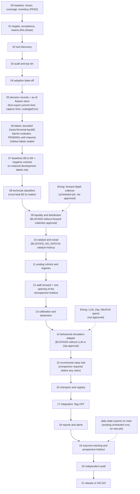

# Dependency graph (frozen in Phase 01)

Order of work and the hard gates between artifacts. Phase order is the package's PHASE_INDEX (00 to 21, one at a time). This file adds the data and evidence dependencies inside that order; a phase that finds an input missing stops at its gate instead of building around it.

## Artifact dependencies

## Hard ordering rules

1. Data provenance before labels: no label is built for a decision whose decision time is not the first export commit time or a recorded capture time (PI-D-011, PI-D-015).
2. Matured labels before training: a training example needs `label_observed_at` >= `label_matures_at` <= the fold's training cutoff; PENDING labels are never trained on or scored (P05, `contract.assert_scorable`).
3. Leakage proof before any metric: the truncation-invariance test of the feature view passes before a single score is computed (P36, P43).
4. Baselines before complex models: B0 to B4 and the negative controls run and are recorded in Phase 07 before any model in Phase 08 is fitted; a complex model is compared with B2, never only with B0.
5. One opening of the retrospective holdout: only in Phase 12, only for the frozen champion and the baselines; every earlier phase sees its counts and censoring only.
6. Calibration before display: no probability leaves the engine before Phase 13's calibration and abstention gate passes for that target (ACCEPTANCE_METRICS.md).
7. Behavioral simulation last and optional: Phase 14 needs approvals that do not exist (PI-D-005), so the expected status is BLOCKED or NO_GO; nothing from a simulator becomes a probability, and no "improvement" is claimed before the Phase 15 comparison against a matched evidence-only baseline, rule-based scenarios, the non-simulation model and abstention.
8. Registry before integration: Phase 17 loads only a model whose sha256, feature-set fingerprint, target version and training cutoff are in the registry (P46, P13).
9. Prospective evidence before VALIDATED_EXPERIMENTAL: requires the Phase 19 prospective holdout (decisions from 2026-10-24) with at least 50 eligible matured events per target.
10. Backtesting stays BACKTEST_NOT_AVAILABLE until a verified engine exists; no phase may infer combined forecast-plus-stress readiness (PI-D-006, P34).

## Gates that can stop the sequence

| Gate | Where | Stops if |
|---|---|---|
| Eligible event counts | 06, 07 | fewer than 100 eligible labeled development events with 20 per class for a target: that target is INSUFFICIENT_HISTORY; if all three primary targets fail, Phase 07 reports base rates only and later modeling phases record NO_GO for lack of data |
| Price source | 06 | GeckoTerminal no longer serves 5-minute candles for the decision window (retention unknown): labels for those decisions are censored, and the coverage report says so |
| Forward collection | 09 | no approval for a scheduled depth collector: liquidity targets stay DEFERRED |
| Paid simulation | 14 | no approval: BLOCKED, core unaffected |
| Merge to main | 17 to 21 | the scheduled runs execute `main`; anything prospective that needs the engine inside a scheduled run waits for Elving's merge (PI-D-005) |
