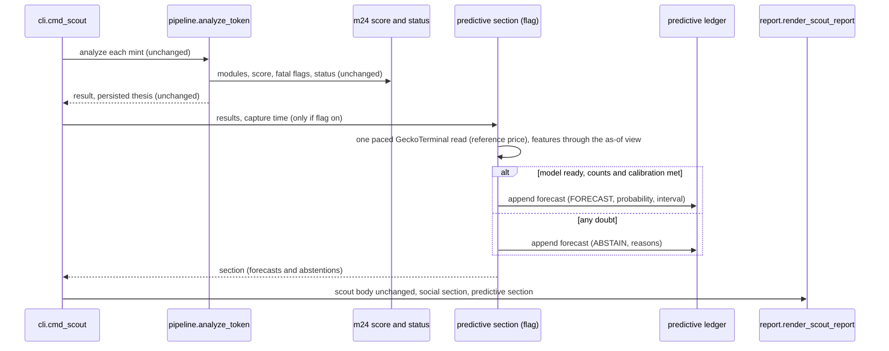
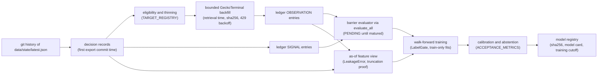

# Planned seams and placement

Where the predictive engine attaches to the existing lab, what it reuses, and what it must not duplicate. Anchors are `file:line` at `94be1bf` (code identical to `f99c6c7`). Placement is a plan for later phases; Phase 01 built only `memelab/predictive/contract.py` (format and registry) and its tests. The full capability matrix is `GAP_MATRIX.csv` (88 cells, every anchor checked by `probes/check_gap_anchors.py`).

## Boundaries

| Boundary | Kind | Lives in | Notes |
|---|---|---|---|
| Decision records | pure functions plus a read-only git reader | `memelab/predictive/decisions.py` (identity and time rule, built in Phase 01 repair pass 2 with tests) and a git reader in Phase 05 | historical: every version of `data/state/latest.json` read from git objects along the first-parent history, oldest first; identity `(mint, created_at, row_sha256)`; decision time = first export holding the exact row (PI-D-015 as amended by PI-D-021); prospective: the scout result plus a capture time |
| Point-in-time features | pure functions over an as-of view | `memelab/predictive/features.py` (Phase 05) | every value carries `feature_available_at`; the view refuses anything later than the decision (LeakageError) |
| Labels | pure evaluator plus the existing ledger | `memelab/predictive/labels.py` (Phase 06) | barrier first-touch per TARGET_REGISTRY.md; PENDING until matured |
| Candle backfill | bounded batch fetch, offline | `memelab/predictive/backfill.py` (Phase 06) | GeckoTerminal only, paced, cached, retrieval time kept |
| Training | batch, offline, train-only fits | `memelab/predictive/models.py` (Phase 07 on) | numpy first; any library choice comes from Phases 03 and 04 |
| Model registry | files with sha256 plus model cards | `memelab/predictive/registry.py` (Phase 16) | nothing like it exists today |
| Inference | bounded, flag-gated, at most one paced GeckoTerminal read at capture (reference price, CC-01) | `memelab/predictive/forecast.py` (Phase 17) | ABSTAIN on any doubt; never blocks the scout |
| Forecast persistence | append-only, hash-chained | Phase 05 decides between the existing ledger journal and one additive namespaced table | never in the tracked lab DB |
| Reports | appended section | `report.render_scout_report` gains an optional argument (Phase 18) | byte-identical when off |
| Behavioral simulation | isolated adapter, optional | outside the core package (Phase 14) | no probability field, SIMULATION_NOT_AVAILABLE by default |
| Backtesting and stress | status only | `contract.backtest_status()` | BACKTEST_NOT_AVAILABLE (PI-D-006) |

## Seam table (reuse first)

| Need | Reuse (existing code) | New code and why it is not a duplicate | Failure mode and degradation |
|---|---|---|---|
| Decision time and identity | state export format (`memelab/state.py:45` export, `memelab/state.py:77` import handles both layouts; `decisions.export_from_doc` reads both the same way); exact mint keys | `decisions.py`: state.py imports one file into a DB keyed on `(mint, created_at)` and keeps whichever row comes first, so it cannot be the decision seam (skeptic CX-S1: a later REJECTED row would inherit an earlier decision time) | an export version that does not parse is skipped and counted; a row seen only in a later export gets that later commit time (never earlier); KEY_CONFLICT flagged and every result repeated without it |
| Leakage control | `replay_core.LeakageError` (`memelab/social/replay_core.py:104`), the audited cutoff view pattern (`:441` Audit, `:457` CutoffView), truncation invariance (`:983` truncate, `:1013` leakage_check) | a cutoff view over decision snapshots and candles; it raises the same LeakageError class and repeats the truncation proof on its own data | a feature that would read past the decision raises and the forecast abstains; the test suite fails if any feature changes when data after the decision are removed |
| Candle availability | `replay_sources.PROVIDER_LAG` (`memelab/social/replay_sources.py:28`, 300 s, HEURISTIC) | none | features use close + 300 s; Phase 05 records that this is HEURISTIC and that a backfill read is not historical availability (P04, P07) |
| Observation validation | `outcomes_core.normalize_observation` (`memelab/social/outcomes_core.py:274`: future-dated candles refused, high and low must contain open and close) and `visible` (`:335`: revisions by availability) | none | a malformed candle is refused with a reason, never repaired |
| Label store and revisions | `outcomes_ledger` journal (`memelab/social/outcomes_ledger.py:53` connect with any path, `:133` add_observations, `:225` evaluate_all with an `evaluator` argument, triggers at `:37` and `:39` refuse UPDATE and DELETE) | a barrier-label evaluator passed as `evaluator`; a separate ledger file (`data/private/predictive_ledger.sqlite`, gitignored); decisions recorded as SIGNAL entries, candles as OBSERVATION entries with `available_at` = retrieval time | a revised candle is a new observation, a changed label a new outcome entry that points at the old one; nothing is rewritten |
| Endpoint returns, MFE/MAE | `outcomes_core.evaluate` (`memelab/social/outcomes_core.py:378`) unchanged | none; the barrier evaluator is a sibling, not a fork | |
| Entry lag and statuses | `outcomes_core.DEFAULT_POLICY` (`memelab/social/outcomes_core.py:42`, execution_lag_s 300, max waits) and `STATUSES` (`memelab/social/outcomes_core.py:35`) | the barrier evaluator maps its classes onto MEASURED (with a class field), PENDING and MISSING | |
| Chronological selection | `replay_core.LabelGate` (`memelab/social/replay_core.py:719`: train, then validate, then a frozen test) | a day-based walk-forward split (`split_bounds` at `memelab/social/replay_core.py:700` is one fractional split) that feeds the same LabelGate | requesting holdout labels before freezing raises LeakageError |
| Matched controls (baseline B4) | `replay_core.controls_for` (`memelab/social/replay_core.py:667`), `alpha_core._baseline` (`memelab/social/alpha_core.py:358`) | an adapter that feeds decision snapshots instead of social records | fewer than 3 controls: no B4 for that event |
| Intervals | `alpha_core.wilson` (`memelab/social/alpha_core.py:125`), `median_ci` (`memelab/social/alpha_core.py:110`), `m28.bootstrap_diff_ci` (`memelab/modules/m28_statistical_analysis.py:276`) | Brier, log loss, reliability bins, day-block and mint-block bootstrap (nothing exists, GAP_MATRIX CALIBRATION_SCORING) | |
| Ranker and fatal flags | `m24.score` (`memelab/modules/m24_opportunity_ranker.py:592`), `fatal_flags` (`:494`), `assign_status` (`:625`) | none. The forecast is computed after them, from the same result, and never passed back | a forecast cannot change score, status, fatal flags, the watchlist or the scout lists; Phase 17 proves m24 outputs identical with the flag on and off |
| Scout hook | `cli.cmd_scout` (`memelab/cli.py:252`) builds the social section from results after scoring (`social_section` at `:226`) | a `predictive_section` built the same way, opt-in (`--predictive` or config), capture time taken there | any exception inside it becomes a visible ABSTAIN with the error class (unlike `pipeline._safe` at `memelab/pipeline.py:19`, which hides module failures, FEATURE_TRACE gap 6) |
| Report | `report.render_scout_report(..., social=None)` (`memelab/report.py:235`, appended at the end, byte-identical when None, `tests/test_social_research.py:146`) | one more optional argument, rendered after the social section | flag off: report byte-identical (Phase 18 golden test) |
| Spend control | `memelab/catalyst/firecrawl.py:522` cap_reason; `social_api_spend` table | a call counter and circuit breaker in the backfill (no paid API is planned) | after 5 consecutive failures the run stops and leaves labels PENDING |
| Scheduled runs | they run `main`'s code (PI-D-005) | none | nothing here reaches them before Elving merges; until then the prospective holdout is built offline from the daily exports |

## What is deliberately not reused

| Existing piece | Why not | Recorded where |
|---|---|---|
| `alpha_store` candle tables (`memelab/social/schema.py`, `social_alpha_series` UNIQUE (chain, contract, source)) | one series per token and source: it cannot keep a re-read (revision) or a pool key | GAP_MATRIX note; the ledger above keeps both |
| `catalyst/monitor.py:64` record_outcomes | first snapshot at or after the horizon with no maximum wait, keyed on ticker links (PI-D-007) | GAP_MATRIX CATALYST x EVENT_LABELS CONFLICT |
| launch cohort `mcap_24h` / `7d` / `30d` | no read time, 19 / 8 / 2 filled, one 22 h cohort | TARGET_REGISTRY not-primary table |
| `theses.created_at` as a clock | collector-run start, written later (PI-D-011) | PI-D-015 |
| stored thesis `score` as a fixed feature | version-dependent (PI-D-008) | features carry the export commit as version |

## Prospective request flow (Phase 17 target)

Failure handling in this flow: model file missing or its sha256 wrong gives ABSTAIN MODEL_NOT_SELECTED; feature-set mismatch gives FEATURE_SCHEMA_MISMATCH (P46); an exception gives ABSTAIN with the error class; the scout output above the appended sections never changes.

## Offline learning flow (Phases 05 to 13)

## Probability and the existing decision rules

- A forecast never feeds the 100-point score, the fatal-flag veto, the status, the watchlist or the order of the scout lists. Fatal flags always win: a fatal-flagged token still gets its forecast or abstention shown, under the unchanged REJECTED line.
- No alert is driven by a probability until a target reaches VALIDATED_EXPERIMENTAL (ACCEPTANCE_METRICS.md); Phase 18 decides alert rules within that limit.
- Flag default OFF (`contract.enabled()` reads `data/config.json` `predictive.enabled`, which must be the JSON value true). The flag gates nothing yet; Phase 17 wires it. Today the package is unreachable because no existing module imports it, which `tests/test_predictive_contract.py` checks on the syntax tree (plain, `from memelab import predictive`, relative and `import_module` or `__import__` string forms).

## Degradation

| Condition | Behavior |
|---|---|
| GeckoTerminal down or rate-limited | label building: labels stay PENDING or MISSING with reasons, never negative, and the run stops at the circuit breaker; inference: the capture read fails and the forecast is ABSTAIN SOURCE_STALE; the scout itself is unaffected |
| Model stale (training cutoff more than 14 days before the decision) | ABSTAIN MODEL_STALE |
| Inputs older than allowed at capture | ABSTAIN SOURCE_STALE (P47) |
| Backtesting engine absent | `backtest_status` BACKTEST_NOT_AVAILABLE on every forecast; no combined claim; the validator refuses an assessment reference without a verified engine (P34) |
| Behavioral simulation absent or unapproved | SIMULATION_NOT_AVAILABLE; `behavioral_scenarios` empty |
| Flag off | no section; report byte-identical |
