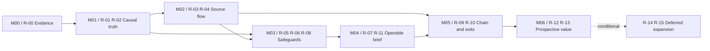

# Remediation Roadmap — Social & Trader Intelligence

**Status:** PROVISIONAL, evidence-constrained consolidation • **Audit date:** 2026-10-13 • **No application fixes made**  
**Repository:** [RyzinEnagy/memelab-inbox](https://github.com/RyzinEnagy/memelab-inbox) • **Publication branch:** `audit/social-intelligence-phase06`  
**Pinned application baseline:** `698f73b854567ce60b56ce275b5ab6822a9d5f60` (`main`) • **Separately reviewed optional feature ref:** `3f27fc788f9ab88286b8041355e5445fdfdf012c`

> **Evidence qualification:** At publication, this branch contains [FINDINGS.md](FINDINGS.md) and [06_STRATEGIC_IMPROVEMENTS.md](06_STRATEGIC_IMPROVEMENTS.md), but NOT `00_BASELINE.md`, `REQUIREMENTS_MATRIX.md`, `01_FUNCTIONAL_AUDIT.md`, `02_ARCHITECTURE_AUDIT.md`, `03_RESEARCH_VALIDITY.md`, `04_ADVERSARIAL_AUDIT.md`, or `05_OPERATIONS_AND_UX.md`. The findings register summarizes earlier work but cannot replace the original reports/test artifacts. Targeted Project Library title searches also did not retrieve them. No fresh tests or live-provider checks were performed in this consolidation. Missing reports and the earlier audit probes/logs must be recovered before claiming a complete independent audit. Phase 03 is also explicitly described as unavailable in the accessible Phase 06 report.

## Original-archive verification follow-up — 2026-10-15 (current)

**M00 remains BLOCKED; M01 is not authorized.** Four original ZIPs now supply 50 preserved files; all 43 embedded checksum entries match. The original Phase 04/05 byte-source gap is closed (indexed copies differ only by final newline). Original staged prompts authenticate all 105 matrix texts. Recovered Phase 00 probes match both refs; original Phase 01 acceptance suite repeats the same 5 failures/17 passes; Phase 04 C microprobes and Phase 05 MODEL arithmetic match their archived outputs without upgrading their grades.

**Correction:** OPS-001–010 are primary labels in the original Phase 05 findings, not solely secondary Phase 06 numbering. Current source/code crosswalk preserves primary grades and severities, including OPS-008 High for stated product objective. No risk priority, scope or implementation authorization changes. Original Phase 03 A–E executable inputs/scripts/raw outputs remain absent; the repeated report/findings uploads do not fill that gap. Recover them or explicitly review a separately labeled replacement replication package with the permanent historical limitation disclosed. Phase 04's terminated-suite raw log remains unavailable. See [current checklist/next steps](M00_ARCHIVE_RECOVERY_VERIFICATION.md), [retrieval ledger](M00_MISSING_EVIDENCE.md), and D-M00-008. All prior full-suite/acceptance evidence remains preserved; no application changes.

## Independent M00 acceptance attempt — 2026-10-14 ET (historical; superseded above)

**BLOCKED — acceptance withheld.** Review of recovery `3b434e1dcc59290d993a638ca615f61b929189bc` independently verifies all 10 recovered-file hashes, four original upload matches, 67 ID mappings and 105 requirements; new pinned-code probes reproduce nine acceptance failures. Original Phase 04/05 bytes and historical requirement/probe/log archives remain unavailable. See [decision/checklist](M00_INDEPENDENT_VERIFICATION.md), [detailed crosswalk](M00_INDEPENDENT_CROSSWALK.md) and [retrieval ledger](M00_MISSING_EVIDENCE.md). OPS-001–010 now map explicitly to Phase 05 paragraphs; labels/severities remain secondary indexing, and modeled operations remain unverified. The original architecture report has 15 ARCH IDs, despite Phase 05's summary of 12.

Both clean full suites completed with the same catalyst failure (baseline 651 pass/1 fail, recovery 658 pass/1 fail, exit 1); prior logger failure did not reproduce and is not closed. No application code or schema changed. **M01/R-01/R-02 remains conditional, not approved.** Recover original evidence and obtain a subsequent explicit independent acceptance decision before revisiting implementation scope or effort. The earlier expanded temporal/provenance acceptance cases remain required; this review does not authorize them to start.

## M00 evidence-recovery addendum — 2026-10-13 (historical recovery checkpoint)

The original Phase 02 architecture and Phase 03 research-validity reports, plus their separate original findings registers, are now recovered byte-for-byte from previous project chats. All **8/8 required primary audit documents are available and checksum verified** (Phase 04/05 only as indexed text); **independent verification remains PENDING**. The published Phase 06 roadmap originally lacked all Phase 03 quantitative findings and detailed AUD-018–033 descriptions. Its historical warning above describes publication time only, **not current recovered M00**. The finding register now covers AUD-001–033. See `M00_RECOVERY_REPORT.md` and `EVIDENCE_CROSSWALK.md`.

| Existing remediation package | Add these original findings and evidence to acceptance | Classification / implication |
|---|---|---|
| **R-01 — historical causal time** | **AUD-024** historical intrabar alpha fill: a decision mid-candle uses prior open or future high/low; **AUD-025** historical wallet USD marks select future prices; **AUD-032** replay export reconfirms AUD-002; **AUD-033** generation-context eligibility may ignore later fetch time; plus original ARCH-001/007 | **P0 trust blocker**. Require adversarial QV-01/QV-02/QV-08: mid-candle open/extrema non-executable; transaction mark available by decision; late-fetched facts rejected; replay export through evaluation causal. These cases were **not** in original R-01 scope and cannot be skipped. |
| **R-01/02 — publication/provenance** | **AUD-020, AUD-021, AUD-026, ARCH-007/009**: immutable dependency chain; failure must report unavailable not zero; in-sample `VALIDATED` must not convey proven predictive effect | Preserve original output with provenance and corrected superseding versions; no causal/forward predictive language on historical associations. |
| **R-02/R-10 — executable outcomes and structure** | **AUD-029, AUD-031** (plus ARCH-002/006 and AUD-018/019): pro-rata quote cannot guarantee a lower bound; all-unquoted aggregate must be UNKNOWN, not numeric zero; inherited safety flags do not prove authorities, taxes or exact-size sell-route | No claim of executable profits without dated size-specific quote and token-authority checks; explicit source coverage; no chain-ambiguous projection; per-connection FK checks. |
| **R-07/R-08 — operations/integrity** | **AUD-022/023, ARCH-005/008/011**, plus existing AUD-007/011: separate stores, missing restore unit, unbounded retention/unknown capacity and red baseline | Restart and restore-injection proof, record missing evidence and capacity telemetry; no 'full E2E' solely from fixture demos. |
| **R-12/R-13 — statistical efficacy** | **AUD-026/027/028/030**: prospective held-out cohort, selection/multiple-testing dependence, confounder-matched controls, coordinated-source uncertainty, original-vs-social incremental precision | Remains **unvalidated** until genuine complete history, executable-depth coverage and forward outcomes. Never certify best trader or buy-signal quality from synthetic replays. |

**Order of operations unchanged:** M00 evidence/integrity and independent acceptance before M01; R-01 knowledge-time and research fill rules before any predictive claim. The R-01 estimated effort of 6–12 person-days may now be **underestimated** because AUD-024/025 require execution-price/valuation policy changes; re-estimate before authorization. Do not treat this addendum as M01 approval or close any finding.

## Execution policy

**This is a plan, not authorization to deploy or trade.** Each phase is independently executable by a fresh engineering session, reads the pinned baseline and prior gate artifacts, makes only its scoped changes, runs positive/negative/restart tests, records exact commands and outputs, then stops. Work on a protected remediation branch or reviewable PR; never silently rebase/rewrite the original audited evidence. Phase names **M00–M06** are prospective remediation phases, distinct from the implementation's historical 00–21 and audit reports 00–07.

**Effort:** estimates are *engineering person-days*, including tests/review and excluding unknown access delays; approximate and sensitive to missing source files. **Exposure/priority:** P0 = publication/trust blocker, P1 = supervised operational blocker, P2 = needed for demonstrated research value, P3 = optional conditional work. **Status types:** C = register-reported confirmed; S = suspected/index-only; V = validation absence; E = enhancement. Findings refer to [FINDINGS.md](FINDINGS.md) and [06_STRATEGIC_IMPROVEMENTS.md](06_STRATEGIC_IMPROVEMENTS.md). All proposed fixes require reproduction on a pinned branch before modification.

## Ranked action registry

| Priority | Action | Finding / type | Severity | Likelihood & impact | Benefit | Effort | Prerequisites | Regression |
|---|---|---|---|---|---|---|---|---|
| P0 | R-00 Evidence reconciliation | Missing 00–05 reports/matrix; AUD-010, C (archive absence) | HIGH process | Certain gap; prevents audit closure | High | 1–3d + recovery | None | Low |
| P0 | R-01 Causal time invariants | AUD-001/002/015/017, ARCH-001; C | **CRITICAL** | Reproduced paths; misleading retrospective research | Very high | 6–12d | R-00 | High |
| P0 | R-02 Provenance/coverage gates | AUD-004/008, ARCH-009, OPS-006; C/V | **CRITICAL** | Reproduced fixture export; false 'real' inference | Very high | 4–8d | R-00, R-01 schema contract | Medium |
| P0 | R-03 Primary source orchestration | AUD-003/014, ARCH-003; C | HIGH | Certain current pipeline gap; core nonfunction | Very high | 6–12d | R-01/02 | High |
| P0 | R-04 Cursors and failure lifecycle | AUD-005/016, ARCH-004/010, OPS-002; C | HIGH | Busy/capped sources & interrupts | High | 4–8d | R-02, R-03 interface | Medium |
| P0 | R-05 Rights, privacy and erasure | AUD-009, ADV-001/002/008/009; C/S | HIGH (could become CRITICAL) | X policy discrepancy confirmed; broader threats unverified | High | 4–10d | R-00, R-02/03 | High |
| P0 | R-06 Metering/credential guards | AUD-006, ADV-003/005/007, OPS-004; C/S | HIGH | Conditional on billable enabling; potential overspend | High | 3–7d | R-00 | Medium |
| P0 | R-08 Reliable test/release truth | AUD-010/011/014, OPS-010; C | HIGH release | Red baseline; fixture E2E overclaim | Very high | 3–7d | R-00, plus affected fixes for final gate | Medium |
| P1 | R-07 Scheduling, state and restore | AUD-007, OPS-001/003/005/009, ARCH-005/011; C/S | HIGH | No proved unattended service | Very high | 7–14d | R-03/04/05/06 | High |
| P1 | R-09 Claim-specific on-chain corroboration | ARCH-006, STR-B05; S/E | HIGH if wrong | Ambiguous claims and wallet labels | High | 4–8d | R-01/02/03 | Medium |
| P1 | R-10 Wallet completeness + executable exits | AUD-012, STR-A05/B08; C/V | HIGH | Truncated history and thin liquidity common | Very high | 6–12d | R-01/02/09 | High |
| P1 | R-11 Coverage-first investor brief | OPS-006/007/008, STR-B07/C04; S/E | MEDIUM | Human confusion, time burden | High | 3–6d | R-02/03/09/10 | Medium |
| P2 | R-12 Prospective benchmark & skill validation | AUD-008/012, STR-B01/B03/B08; V/E | HIGH claim risk | No measured real predictive value | Very high information gain | 5–10d setup + 30/60/90d observations | R-01–11 | Medium |
| P2 | R-13 Origin independence & stage-of-promotion | STR-B02/B04, STR-002/004; E | ENHANCEMENT | Value plausible, not validated | Conditional high | 5–10d | R-03, R-09, R-12 cohort | High |
| P3 | R-14 Optional adapters / Discord | AUD-013, STR-E02/B06; C/E | MEDIUM optional | Source breadth without proven use | Conditional | 3–10d/platform | R-03/04/12 | High |
| P3 | R-15 Simplify and economize modules | STR-C01–C04/E03; E | ENHANCEMENT | Potential maintenance/spend savings | Conditional | 3–8d | R-07/11/12 | Medium |

**Risk ranking note:** R-06 has lower exposure while billing remains off, but is cheap, severe if activated, and mandatory before any paid connector. R-08 is a quick leverage fix but a green suite cannot supersede R-01/03/12. R-12's time-to-benefit is long; start locked measurement as soon as trustworthy operations exist, rather than writing a premature high-confidence score.

## Per-action technical contracts and acceptance tests

### R-00 — Restore the evidence baseline and reconcile requirements
- **Finding/status:** missing audit inputs; AUD-010 release drift. C for missing branch content, unknown contents of absent records. **Problem/evidence:** Git branch inventory shows only `FINDINGS.md` and `06_STRATEGIC_IMPROVEMENTS.md`; the latter acknowledges Phase 03 missing and prior archive location.
- **Likely cause:** audit outputs distributed across chat/Library/branches without canonical, pinned manifest.
- **Solution / files:** restore read-only copies of `00_BASELINE.md`, `REQUIREMENTS_MATRIX.md`, `01–05` reports and probe/log evidence into reviewable evidence storage (subject to source rights); create SHA-256 artifact manifest, IDs/evidence-line reconciliation and requirement-to-defect matrix. Never invent absent material.
- **Dependency:** none. **Acceptance:** 8/8 requested source reports/register/matrix files accounted for (or explicitly BLOCKED with owner and retrieval method); every AUD/ARCH/ADV/OPS ID mapped to original page/path/line/probe and baseline ref; discrepancy/duplicate count documented. **Regression:** publication of private text or secrets; protect artifact handling. **Effort/Priority:** 1–3d + access delays / P0.

### R-01 — Make every historical answer knowledge-time correct
- **Findings/status:** AUD-001/002/015/017, ARCH-001; C. **Evidence:** late extracted claim in historical narrative; replay export backdates `extracted_at=10000` to `available_at=120`; explicitly future feed run returned under earlier `--as-of`; chronology run flags derived a day later appear historically.
- **Likely cause:** using occurrence time/current latest rows instead of versioned availability timestamps throughout readers.
- **Solution / components:** define immutable `occurred_at`, `observed_at`, `extracted_at`, `reviewed_at`, `available_at` and supersession semantics; migrate/retain unknown times conservatively; enforce causal views in `narratives.py`, `replay_sources.py`, `feed_store.py`, `chrono_store.py`, export/report/alpha and wallet assertions.
- **Dependencies:** R-00 and a versioned schema/fixture plan. **Acceptance:** recompute output at cutoff T after injecting later extractions, identity edits, approvals, flag runs, feed IDs, price bars and wallet links; identical result; export then replay is equally causal; explicit future run either rejected or clearly rendered as future; every published input's `available_at<=T`. **Regression:** old snapshot compatibility, migrations, reproducibility; compare before/after outputs and refuse unverifiable historical backfill. **Effort/Priority:** 6–12d / P0.

### R-02 — Hard eligibility, fixture isolation and absence semantics
- **Findings/status:** AUD-004/008, ARCH-009, OPS-006; C/V. **Evidence:** `alpha_store.py::build_input` hardcodes `is_fixture=False`, loads fixture claims/series.
- **Likely cause:** fixture/provenance and COMPLETE/PARTIAL statuses absent from shared publication contract.
- **Solution / components:** typed source/run/evidence provenance, coverage-denominator manifests, `is_fixture` propagated through claims/series/scores/reports; reject ambiguous 'real' inputs; abstain on unknown prices/wallet history.
- **Dependencies:** R-01 time contract. **Acceptance:** mixed fixture/live DB cannot output nonfixture alpha containing synthetic lineage; any missing source/quote/candle is explicit PARTIAL/STALE/UNKNOWN; known complete absence alone says NO QUALIFYING SIGNAL; randomized fixture contamination and downstream render tests pass. **Regression:** fewer published cases, schema incompatibility; preserve honest experimental access with labels. **Effort/Priority:** 4–8d / P0.

### R-03 — One authorized X/Telegram observation-to-outcome chain
- **Findings/status:** AUD-003/014, ARCH-003; C. **Evidence:** source content discarded/hashed; observations ingested without automatic extraction/resolution. Fixture release independently orchestrates separate stages.
- **Likely cause:** unimplemented rights-aware private text transport and idempotent job handoff.
- **Solution / components:** `x_api.py`, `telegram_bot.py`, `ingest.py`, `extraction.py`, identity/narratives/feed/alert/outcome CLIs; minimal rights-aware private text handoff + durable status/outbox; never publish licensed raw text.
- **Dependencies:** R-01/02, consent/retention contract R-05. **Acceptance:** with an authorized source, one real post with mint and claim traverses acquisition → verified identity → claim evidence → narrative → corroboration/UNKNOWN → readable report → alert dry run → forward outcome record; shared IDs and timestamps traceable; zero false ticker merge; replay/restart/retry generates no duplicates and no missing chain. Real source transport and fixture-only proofs labeled separately. **Regression:** private text leakage, duplicate model charges, false automatic mint mapping. **Effort/Priority:** 6–12d / P0.

### R-04 — Lossless cursors and recoverable adapter failures
- **Findings/status:** AUD-005/016, OPS-002/ARCH-004/010; C/index. **Evidence:** X page cap advances newest cursor past backlog; custom iterator exception strands RUNNING run.
- **Likely cause:** high watermark and backlog acknowledgment conflated; iterator advancement not under terminal lifecycle guard.
- **Solution / components:** `x_api.py` cursor store, `ingest.py` iterator/status, retry/health/source coverage; separate head/backlog watermarks and per-page commit acknowledgment.
- **Dependencies:** R-02/03. **Acceptance:** after two page-limited runs, a 429, provider partial failure, malformed item and iterator TimeoutError, all eligible fixture IDs eventually recover without duplicates; no stale RUNNING; gap remains visible until repaired; last_status reflects unresolved gaps. **Regression:** billable re-reads, out-of-order events; test rate and exactly-once downstream effects. **Effort/Priority:** 4–8d / P0.

### R-05 — Enforce source rights, retention, private-data protection
- **Findings/status:** AUD-009 C; ADV-001/002/004/008/009 S (index-only). **Evidence:** X recheck marks NOT_FOUND without end-to-end purge; other issues require source report verification.
- **Likely cause:** deletion policy disconnected from source/derivative/private/export lifecycle; permissive state boundaries suspected.
- **Solution / components:** X tombstones + purge/invalidations across private SQLite, public hashes, extraction cache, snapshots, artifacts and retention/backup policy; least-privilege private file permissions, safe transport logs/content guards.
- **Dependencies:** R-00, R-02/03. **Acceptance:** synthetic deleted source not retrievable after defined policy window from permitted surfaces, cache, export, alerts or normal restore; no private raw text in Git/report/log; mode 0600 equivalent where required; error/redaction/content guard malicious-input suite; legal/platform-specific rule approved separately. **Regression:** erasing legitimate audit evidence, unbounded backup rewrite; preserve permitted tombstone lineage. **Effort/Priority:** 4–10d / P0.

### R-06 — Defensible billable API and model budget guard
- **Findings/status:** AUD-006 C arithmetic, ADV-003/005/007 and OPS-004 S/index. **Evidence:** cap=0, zero configured input/output prices permits live-enabled guard path; no actual paid call was made.
- **Likely cause:** prices accepted as zero estimates, budget accounting not transactional, credential/error paths under-tested.
- **Solution / components:** `llm.py`, provider configuration, billable source guard, spend reservation/reconciliation ledger; require explicit verified positive tariffs or explicit verified truly free mode, prevent missing-usage loopholes.
- **Dependencies:** R-00; before enabling paid R-03. **Acceptance:** fake-transport concurrent requests cannot exceed cap even when usage reports are delayed/missing; zero/negative/unverified price refuses enabled billable calls; 401/429/bad model output cannot reveal keys; tests make **zero** real charges. **Regression:** unnecessarily blocking free offline work; separate exempt verified-free policy. **Effort/Priority:** 3–7d / P0.

### R-07 — Operable scheduler, outbox, all-store backup and outcomes
- **Findings/status:** AUD-007, OPS-001/003/005/009; C/S. **Evidence:** schedule templates disabled, record_signal not wired through flow; new social tables absent from state export; no observed autonomous run.
- **Likely cause:** separate CLI fragments without one persistent host, retry ledger or full restore contract.
- **Solution / components:** `alerts_schedule.py`, `outcomes_ledger.py`, `state.py`, store/outbox and operations runbook; durable supervised scheduler with acknowledgments, delivery receipts and encrypted multi-store snapshots.
- **Dependencies:** R-03/04/05/06. **Acceptance:** fault-injected seven-day simulation + authorized supervised live run includes missed-job, crash-after-send, reboot and stale API; no undetected gaps, duplicated alerts or lost outcome; backup/restore checksum and post-restore replay pass; measured storage and p95 processing time; external scheduler status verified, not guessed. **Regression:** concurrency, cross-store duplication and leaked backups. **Effort/Priority:** 7–14d / P1.

### R-08 — Fix baseline tests and replace release theater with end-to-end proof
- **Findings/status:** AUD-010/011/014; C. **Evidence:** 1 failing catalyst test, BRETT report written to checkout, disconnected 45/71 staged demos; branch/docs drift.
- **Likely cause:** time-dependent fixtures, output path coupling, release gate defined as command success rather than one evidence chain.
- **Solution / components:** `tests/test_catalyst.py`, report-output tests, `tools/release_e2e.py`, release docs and branch-pinned manifest; control clock and tempfile paths; add negative E2E, keep existing fixture suite as component evidence.
- **Dependencies:** R-00 immediately, R-01/03/04 for full integration gate. **Acceptance:** clean checkout full suite returns 0 with no untracked outputs; same baseline commit and exact commands logged; one vertical test shares IDs/source and produces real integrated result; branch/source coverage and known disabled routes documented; fixture pass never labeled live readiness. **Regression:** false test fixes by weakening assertions; require old failed case explained, deterministic time injection. **Effort/Priority:** 3–7d / P0.

### R-09 — Predicate-level on-chain fact checking
- **Findings/status:** ARCH-006 S/index; STR-B05 E; AUD-008 V. **Evidence:** strategic report observes wallet evidence but unproven same-time claim-specific corroboration.
- **Likely cause:** social summaries and wallet/risk observations joined by token/theme rather than falsifiable claim/time/transaction predicate.
- **Solution / components:** claim schema, identity and token authorities, Helius/event adapters, reports; attach tx signatures, pool IDs, evidence-known-at clocks and independent contradiction.
- **Dependencies:** R-01/02/03. **Acceptance:** labeled set proves 'exchange transfer' not a swap; only transactions support completed buys/sells; custody/LP/authority classified UNKNOWN if unverifiable; Solana mint mismatch rejected; same-time lookup excludes later records. **Regression:** misclassified custody, wrong-chain collisions, API cost. **Effort/Priority:** 4–8d / P1.

### R-10 — Realistic wallet/accounting and executable exit checks
- **Findings/status:** AUD-012 C/limitation, AUD-008 V; STR-A05/B08 E. **Evidence:** short default imported history, inferred completeness from fetch sizes, supplied prices; no full real-wallet execution proof.
- **Likely cause:** incomplete inventory, fees and route depth treated as potentially equivalent to complete P&L.
- **Solution / components:** `wallet_activity.py`, `perf_store.py`, ranking inputs, read-only Jupiter/DEX quote adapter and final report; disclose missing history/authority/fee risk.
- **Dependencies:** R-01/02/09. **Acceptance:** paginated wallet dataset with opening inventory, transfers, token decimals, gas/transfer fees and partial history returns either complete reconciliation or explicit abstention; same token at different sizes ($250/$1k/$5k/$25k where appropriate) yields dated net quote or NO QUOTE, never chart-price implied proceeds; no signing/trading calls. **Regression:** stale quotes, rate limits and unjustified account-to-person association. **Effort/Priority:** 6–12d / P1.

### R-11 — One honest and scannable investor research case
- **Findings/status:** OPS-006/007/008 S; STR-B07/C04 E. **Evidence:** unproven time savings and multiple feed/digest surfaces; report has no assured complete coverage.
- **Likely cause:** component-first UI rather than decision-first representation.
- **Solution / components:** reports/feed/alerts; single 3–5 cases/day maximum (zero allowed) with drilldown IDs, contradiction/UNKNOWN, confidence, source dependency, token risk, trade-size net exit and freshness/expiry. Preserve existing semantics.
- **Dependencies:** R-02/03/09/10. **Acceptance:** five blind users or predefined reviewer tasks classify chain, signal, unknowns, actionable checks and invalidation under five minutes per case; COMPLETE NO SIGNAL distinguished from PARTIAL/STALE; summaries and drilldowns reconcile exactly; critical risk notices never omitted by cap. **Regression:** high filtering false negatives; audit random rejected cases. **Effort/Priority:** 3–6d / P1.

### R-12 — Lock prospective usefulness, not hindsight alpha
- **Findings/status:** AUD-008 V; STR-B01/B03/B08 E; OPS-008 S. **Evidence:** only fixtures/supplied ledgers and real replay INSUFFICIENT_DATA; no demonstrated baseline advantage.
- **Likely cause:** no contemporaneously recorded, full-universe, independent forward outcome cohort.
- **Solution / components:** forward outcome ledger, alpha/performance/replay, same-time DEX/GMGN/Kaito-compatible baselines, human research time/cost, scoring protocol; preregister chains, source universe, eligibility, losers/delistings and hypothesis before outcomes.
- **Dependencies:** R-01 through R-11 relevant gates. **Acceptance:** 30-day shadow evaluation then 60–90-day prospective comparison if adequate sample; fixed research attention/time and same information clocks; precision@5, tradeable independent lead time, cost/useful case, calibration, paired clustered uncertainty and missingness published; `INSUFFICIENT_DATA` if weak evidence; no claimed positive returns from modeled price alone. **Regression:** experiment tuning, survivor selection, overlapping-sample pseudo-independence. **Effort/Priority:** 5–10d setup + 30–90 elapsed days / P2.

### R-13 — Independently sourced narrative and promotion/skill research
- **Findings/status:** STR-B02/B03/B04/B06/B08 E; STR-002/003/004/009 V. **Evidence:** explicit repost collapse exists; organic versus copied/paid narrative and expertise not validated.
- **Likely cause:** attention/repetition metrics do not measure independent knowledge or unbiased trading skill.
- **Solution / components:** source-dependency graph, labeled sponsored and syndication edges, human-reviewed accuracy by claim type, holder flow comparison and skill shrinkage; avoid identity accusations.
- **Dependencies:** R-03/09/10/12 baseline. **Acceptance:** blinded corpus reports precision/recall of origins, false common-control merges, source claim calibration/Brier scores, unseen-period stability, adverse distribution warning precision; an improvement over simpler repost/risk baseline without materially raising false alerts. **Regression:** defamation/overmerging, privacy rights and overfitting. **Effort/Priority:** 5–10d build + labeling / P2 conditional.

### R-14 — Optional provider breadth gated by incremental gain
- **Findings/status:** AUD-013 C on feature, AUD-010 C, STR-E02 E. **Evidence:** Discord Gateway CLI explicitly refuses live nonfixture mode; main excludes optional source expansion.
- **Likely cause:** platform adapters added before one core live data flow was validated.
- **Solution / components:** maintain a separate feature-branch contract; ship no live transport by implication; implement Gateway or other optional adapter only with consent/permissions, recovery and quantified unique signal. 
- **Dependencies:** R-03/04/12 and explicit platform approval. **Acceptance:** each new platform passes real rights-approved fresh/edit/delete/retry/reconnect tests and adds independently useful early cases per marginal $/hour versus baseline; otherwise remain disabled. **Regression:** costs, Terms and transport state. **Effort/Priority:** 3–10d/platform / P3.

### R-15 — Simplify/optimize only with evidence
- **Findings/status:** STR-C01–C04/E03 E, ARCH-015 S/index. **Evidence:** existing modular SQLite architecture has no measured concurrency limit; popular market data already exists.
- **Likely cause:** duplicate views/provider spend and maintenance obligations could exceed delivered decision value.
- **Solution / components:** retain SQLite with small outbox, common provider lifecycle contracts, deterministic prefilter + exploration audit, one case view, reuse DEX data.
- **Dependencies:** R-07/11/12. **Acceptance:** fixed workload test reports p95 end-to-end lag, bytes/day, billed calls, false negatives and $/useful verified case; no lost inference/review states; no distributed rewrite without documented saturation. **Regression:** prefilter recall, abstraction hiding source-specific terms. **Effort/Priority:** 3–8d / P3.

## Dependency graph

**Multi-issue leverage:** R-01 fixes four causal symptoms and restores backtest validity; R-02 prevents fixture contamination *and* misleading no-signal states; R-03 plus R-04 solves data delivery and retry continuity; R-07 plus R-08 makes full work reproducible; R-09 plus R-10 connects factual evidence to trade execution constraints. These should be shared platform changes, not separate patches per symptom.

## Independently executable remediation phases

### M00 — Restore audit authority (R-00)
- **Principal objective:** complete a pinned, reproducible audit evidence/requirements manifest before modifying code.
- **Dependencies:** Git read access and original audit archive owners; no implementation prerequisites. **Bounded scope:** recover 00–05, requirements matrix, evidence logs; reconcile indexed ARCH/ADV/OPS IDs and baseline; no production changes.
- **Deliverables:** checksum manifest; requirement/finding/evidence crosswalk; unresolved contradictions; corrected priority labels; new named proof-owner for every missing artifact.
- **Acceptance:** all 8 requested input paths found and readable *or explicit BLOCKED with no promoted confidence*; every consolidated row maps to inspectable code/test/doc; original severity and normalized severity both retained.
- **Completion gate:** PASS requires artifacts and crosswalk independently reviewed; otherwise **BLOCKED** and implementation may not claim a final audit.
- **Handoff:** pinned refs, hashes, full report index, all unavailable sources and next exact command; update `ROADMAP/DECISIONS/HANDOFF` under reviewed branch; STOP.

### M01 — Historical causality and real-data eligibility (R-01, R-02)
- **Principal objective:** ensure no output can present future-known or synthetic information as historical real evidence.
- **Dependencies:** M00 gate; approved schema migration approach. **Scope:** causal readers/exports, fixture and coverage/unknown status; not new providers or UI.
- **Deliverables:** versioned knowledge-time contract, migrations, negative invariant suite, before/after evidence matrix.
- **Acceptance:** injected-future mutation, replay-export, explicit-ID, flag-revision, wallet-link and mixed-fixture property tests pass; historical output stable across late data.
- **Completion gate:** clean deterministic tests + reviewer signs off that missing clocks abstain rather than fabricate.
- **Handoff:** migration rollback and old/new snapshot comparison, test transcript, any unresolved data quality; STOP.

### M02 — One lossless provider-to-claim vertical slice (R-03, R-04)
- **Principal objective:** transform authorized primary-source posts into traceable contract claims reliably.
- **Dependencies:** M01; privacy/retention design approved before real content is stored. **Scope:** X and Telegram rights-aware ingestion → resolution/extraction/narratives; contiguous cursor and iterator-finalization logic. No optional Discord/Reddit/YouTube.
- **Deliverables:** idempotent work queue, provider lifecycle contract, source coverage report, one end-to-end scenario and interruption records.
- **Acceptance:** exactly one evidence chain at dry-run output for one authorized source; two-page cap, 429, timeout, crash-after-page, retried and malformed records recover without gaps or false DONE status; raw text never in public repo.
- **Completion gate:** independent test runner reproduces same scenario twice including restart with stable evidence IDs.
- **Handoff:** exact permissions/providers used, costs=0/actual metered, gaps, test IDs and next step; STOP.

### M03 — Safety and truthful release tests (R-05, R-06, R-08)
- **Principal objective:** permit controlled supervised use without unchecked private-data, cost or release-evidence exposure.
- **Dependencies:** M01/M02 test interfaces and M00 ADV source recovery. **Scope:** rights/erasure/private security, atomic fake billing, deterministic suite and integrated release smoke path; no paid services without separate approval.
- **Deliverables:** retention/erasure tests, redacted logs, budget reservation harness, all-green suite or explicitly failed gate, pinned source manifest.
- **Acceptance:** concurrency cannot exceed fake cap; deleted source disappears per policy from allowed derivatives/restore; no secrets in public artifacts; baseline catalyst failure genuinely resolved without weakening assertion; release chain one dataset.
- **Completion gate:** **PASS only** with 0 unresolved critical/high assertions and pinned output test log. An unresolved privacy/budget finding blocks billable or live mode.
- **Handoff:** residual risks, approvals, branch, restore state and proof logs; STOP.

### M04 — Persistent supervised research service (R-07, R-11)
- **Principal objective:** run one dependable, interpretable recurring research workflow rather than manual disconnected demos.
- **Dependencies:** M02/M03. **Scope:** durable scheduled jobs, idempotent alert/outcome ledger, full-state encrypted backup/restore, coverage-first daily brief. No predictive-skill labels.
- **Deliverables:** job schedule/runbook, watchdog, delivery/outcome receipts, backup test report, representative 0–5 case briefs and drilldowns.
- **Acceptance:** seven-day fault-injection and authorized supervised run with missed timer/crash/restart/retry; every expected run accounted for; independent restore passes; NO SIGNAL shown only for complete coverage; reports link IDs.
- **Completion gate:** reproducible supervised trial; real external connectivity explicitly PASS/BLOCKED, never assumed.
- **Handoff:** operating cost, source gaps, restore key handling location (not secrets), measured missed events and known disabled integrations; STOP.

### M05 — Claim-to-chain and executable-risk research (R-09, R-10)
- **Principal objective:** every candidate brief distinguishes asserted, verified, uncertain and *sellable* results.
- **Dependencies:** M01/M02/M04. **Scope:** Solana exact mint and authorities, targeted on-chain claim validation, real/explicitly modeled wallet accounting, dated read-only exit quotes; do not execute transactions.
- **Deliverables:** verified example/counterexample set, wallet completeness flags, size-dependent quote/NO QUOTE cards, risk contradictions and timestamps.
- **Acceptance:** wrong mint/chain and custody-as-person rejected; exchange transfer never misreported as sale; multi-size exit quote and fee/route stress visible; stale/no-route/partial history refuses certainty.
- **Completion gate:** independent analyst can reproduce factual chain and interpret available exit proceeds for every displayed test case.
- **Handoff:** quote age and access constraints, cost, manual reviews required; STOP.

### M06 — Decide value using prospective evidence (R-12, conditional R-13)
- **Principal objective:** determine whether the verified system improves research against simpler alternatives at a fixed effort and cost.
- **Dependencies:** M01–M05 plus prospective consent and preregistered analysis. **Scope:** fixed 20–50-source pilot, full loser-inclusive cohort, matching baseline snapshots and human case grading; add origin graph only if blinded error analysis justifies it.
- **Deliverables:** preregistration, sampling log, 30-day shadow results, gated 60–90-day prospective follow-up, uncertainty-quantified decision memo.
- **Acceptance:** paired, independent-opportunity uncertainty on lead-time/precision@5/cost/time; no future bars or survivor filter; all quote failures retained; refuse skill/alpha conclusions if sample too small.
- **Completion gate:** **GO / NARROW / STOP** decision based on measured incremental value; if insufficient data, preserve limited/supervised state rather than hallucinating a winner.
- **Handoff:** frozen cohort, policy versions, baseline comparison code/data rights, elapsed periods, cost and decisions; STOP.

**Deferred conditional backlog (not a placeholder implementation phase):** R-14 Discord/Reddit/Farcaster/YouTube optional expansion and R-15 redesign/optimization. They receive phase authorization only after M06 demonstrates a measurable problem or benefit. Advanced semantic retrieval, coordination networks and adaptive ML are likewise *not authorized* by this roadmap.

## Cross-phase release and handoff rules

Every phase produces: (1) exact commit/ref, (2) changed modules and migrations, (3) reproducible commands, positive/negative/integration tests and logs, (4) security/budget/rights signoff, (5) remaining risks with owners, (6) rollback/backup proof, (7) `EXECUTION.md`, `ROADMAP.md`, `DECISIONS.md`, `HANDOFF.md` changes as applicable, (8) PASS/FAILED/BLOCKED/NEEDS REVIEW state, (9) next one authorized phase and stop. A gate cannot be passed by documentation, mock transport, or a pass counter alone.

**Current gate:** M00 not satisfied; seven source documents absent from the accessible audit branch, including the required requirements matrix and Phase 03 validity report. **Do not implement fixes under this publication task.**
